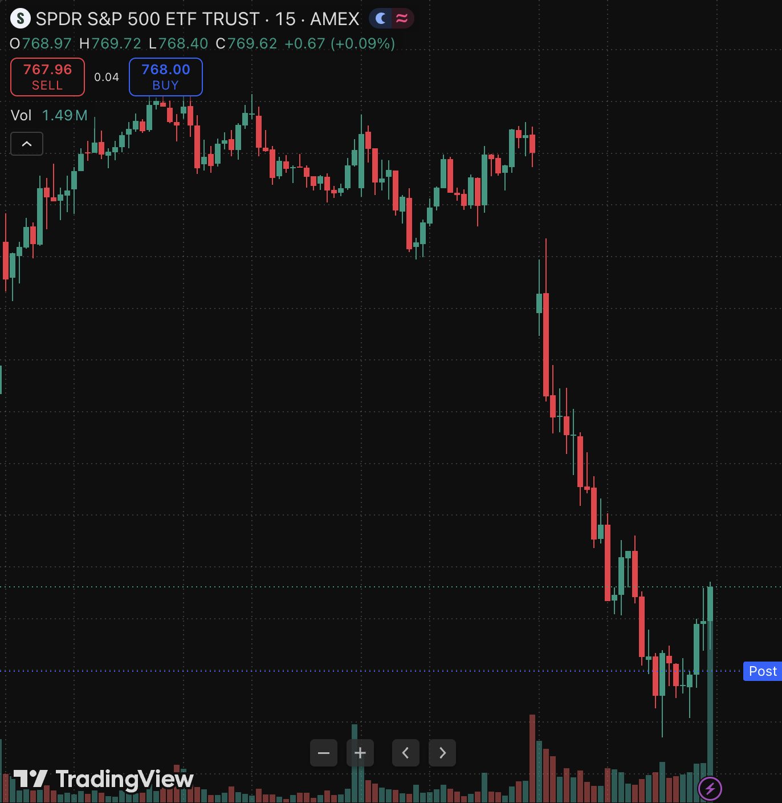

# atlas-signal

A Claude Code slash command that turns a live TradingView chart into a structured trade signal: long and short entries, two take-profit targets, a stop-loss, and a written rationale. It reads price data from TradingView Desktop through the [TradingView MCP server](https://github.com/LewisWJackson/tradingview-mcp-jackson), computes the indicators itself, and formats the result like a Discord signal alert.

```
/atlas SPY option 0dte
/atlas NVDA stock week
/atlas BTCUSD stock 60
```

## What it produces

A real run of `/atlas SPY stock day` (v2 rules), made after the close on October 14, 2026:

```
Signal Alert

- Current Price: 769.62
- Timeframe: end of day (15), based on the Oct 14 close; levels for the next session

Long
- Entry: 770.00
- TP1: 773.28
- TP2: 776.55
- SL: 768.37
- R:R to TP1: 2.00

Short
- Entry: 768.40
- TP1: 765.13
- TP2: 761.85
- SL: 770.04
- R:R to TP1: 2.00

Reason:
- Price Action: below VWAP 770.31, above 9 EMA 768.78, below 20 EMA 769.76
- Key Levels: recent high 772.60, recent low 766.70, VWAP 770.31 (closest, immediate resistance)
- News and Metrics: Manual check recommended (no news source connected)
- Impact: hold 770.00 and 773.28 is next; lose 768.40 and 765.13 is next
```



On the same chart, the v1 rules put the long target $0.31 above the entry and the stop $3.30 below it. v2 puts the target $3.28 above and the stop $1.63 below. The [backtest](#backtest) explains the change, and why it still isn't an edge.

## Methodology

### Timeframe mapping

| Input   | Chart resolution | Horizon                  |
|---------|------------------|--------------------------|
| `0dte`  | 5 min            | today's close            |
| `day`   | 15 min           | end of today             |
| `week`  | 1 hour           | this week's Friday expiry |
| `month` | Daily            | next monthly expiry      |

Any raw TradingView resolution (`1`, `5`, `15`, `60`, `240`, `D`, `W`, `M`) also works.

### Indicators (computed from the last 100 bars)

- **VWAP**, session-anchored: Σ(typical price × volume) / Σ(volume), where typical price = (H + L + C) / 3. The session start is detected as the last gap of more than one hour between bars.
- **9 EMA and 20 EMA**: standard exponential moving averages, smoothing factor k = 2 / (n + 1).
- **ATR(14)**: average true range with Wilder smoothing, the way TradingView computes it.
- **Swing levels**: highest high and lowest low of the last 20 bars, plus the second-highest and second-lowest local extremes (excluding the two most recent bars). They feed the Reason block and the optional confluence filter.
- **RSI**: read from the chart if it's already there, otherwise reported as `n/a`.

### Level construction (v2)

A price buffer is scaled to the instrument's typical volatility: 0.05% for index ETFs (SPY, QQQ, IWM), 0.15% for single stocks, 0.25% for crypto.

| Level | Long rule |
|-------|-----------|
| Entry | max(last price, 9 EMA) + buffer: a breakout entry, unchanged from v1 |
| SL    | entry − 1.5 × ATR |
| TP1   | entry + 2 × the stop distance (3 ATR) |
| TP2   | entry + 4 × the stop distance (6 ATR) |

The short side mirrors these rules. The 1.5 ATR stop and the 2:1 target were picked from 12 variants by a rule fixed before testing ([plan](backtest/v2-plan.md)). A side is printed as `No valid long setup: {reason}` when its target or stop is on the wrong side of the entry, or when reward:risk is below 1. With the current settings every setup passes, so the check is there to catch future rule changes. An optional confluence filter (off, because it didn't help in the backtest) only takes longs above VWAP with no swing high between the entry and TP1. Shorts mirror it. The v1 rules are in the [changelog](CHANGELOG.md).

### Options contracts

When `option` is passed, the command does not invent strikes. TradingView's options data can't be reached from the chart (see [engineering notes](docs/engineering-notes.md)), so the output names the data sources that would make contract selection possible (Unusual Whales, Polygon.io, or a pasted chain) and delivers the technical levels on their own.

## Design decisions

- **Compute indicators in-page instead of adding studies.** TradingView's Basic plan caps user indicators at two, and the MCP's add-indicator tool fails silently. Running the math in a single JavaScript call against the chart's own bar data is exact and costs one round-trip.
- **Rules live in code.** In v1, Claude worked out the levels from rules written in prose, so two runs could compute them differently, and the backtest couldn't be sure it was testing what the command did. In v2, the in-page script computes every level and Claude only formats the output. [`check_parity.py`](backtest/check_parity.py) runs that same script in Node against the backtest's data and confirms every level matches to the cent on all 4,823 bars.
- **No fabricated data.** Missing RSI shows as `n/a`, missing options data is stated, and the news section asks for a manual check. Every signal ends with a disclaimer that states the backtest result.
- **Market-state awareness.** On weekends or holidays, the signal is framed as levels for the next session's open.

## Backtest

I tested the rules on every 15-minute bar of SPY from January 2 to October 14, 2026 (197 sessions). Each test used only the data the command would have seen at that moment and charged $0.02 per share for spread and slippage. Full method and tables: [backtest/RESULTS.md](backtest/RESULTS.md).

v1 showed no edge. For v2, I [wrote the test plan down and committed it](backtest/v2-plan.md) before running anything: 12 variants of ATR-based stops and targets, with the best one picked on January–June data only and then checked once on July–October.

| Average result per trade, after costs | Jan–Jun (variant picked here) | Jul–Oct (not seen during selection) |
|---|---|---|
| v1 | −0.117 R | −0.102 R |
| v2 | −0.019 R | −0.063 R |

*R = the distance from entry to stop, so −0.10 R means losing a tenth of the amount risked per trade. Signals from every bar, long and short pooled.*

v2 loses less, but it has no edge either: on the July–October data its 95% confidence interval runs from −0.148 R to +0.031 R. Two other findings shaped the conclusions:

- **v2's targets rarely come into play.** TP1 is 3 ATR away and gets hit first on only 7–13% of trades, while 55–62% are still open at the close. In practice v2 is a breakout entry with a wide stop, held to the close.
- **15-minute bars can't settle everything.** When one bar touches both the stop and the target, the data can't say which came first. Assuming the stop came first, v1 loses 0.10–0.12 R per trade. Assuming the target came first, it breaks even. v2 stays negative either way.

## Requirements

- [Claude Code](https://claude.com/claude-code)
- TradingView Desktop, running
- [tradingview-mcp-jackson](https://github.com/LewisWJackson/tradingview-mcp-jackson) connected to Claude Code
- To rerun the backtest: Python 3 and Node.js

## Install

Copy the command into your Claude Code commands folder:

```bash
cp .claude/commands/atlas.md ~/.claude/commands/
```

Or clone this repo and run Claude Code from inside it. The command is picked up from `.claude/commands/` automatically.

## Limitations

- Technical levels only. No order flow, gamma exposure (GEX), or options Greeks.
- No news feed. Earnings dates, macro releases and headlines have to be checked by hand.
- No demonstrated edge. The [backtest](#backtest) covers SPY, the `day` setting and January–October 2026 only. Other symbols and timeframes run the same rules untested.

## Disclaimer

This is a personal project for learning and research. It is not financial advice, and nothing it outputs is a recommendation to buy or sell any security. The output format is modeled on the "Atlas Bot" Discord signal style. This project is not affiliated with Atlas Bot or TradingView.

---

Built with Claude Code.
